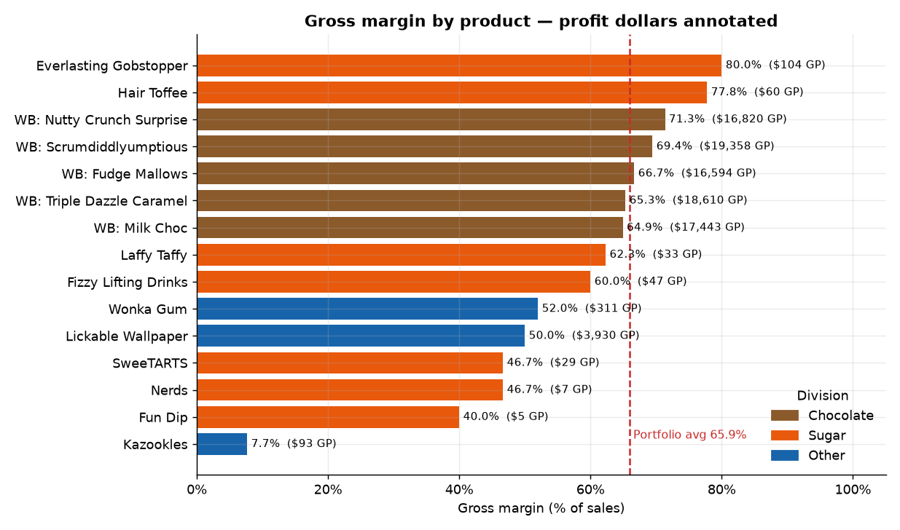
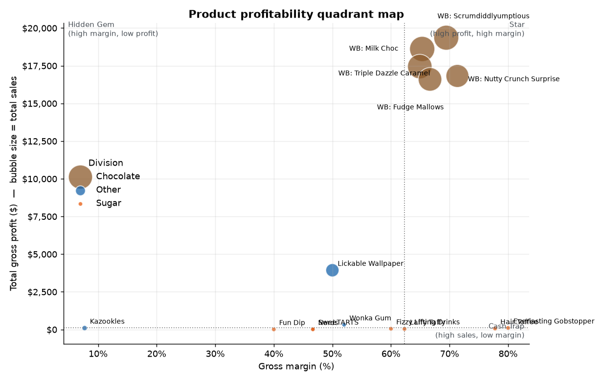
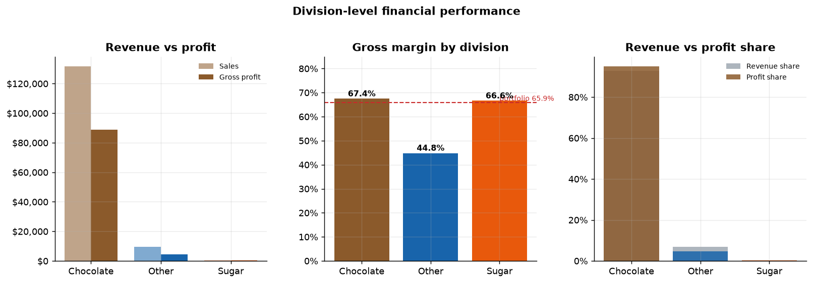
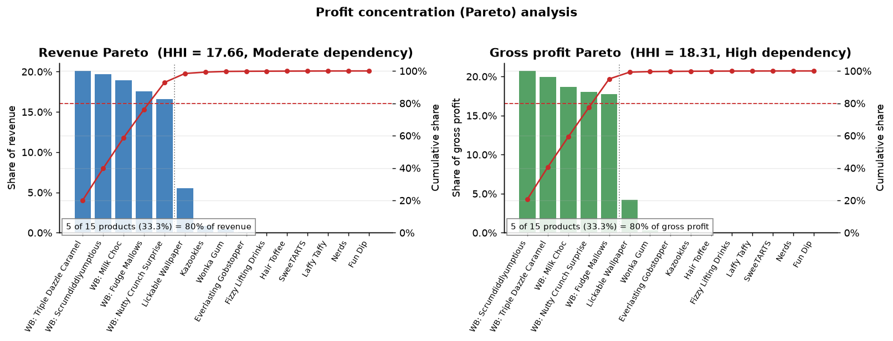
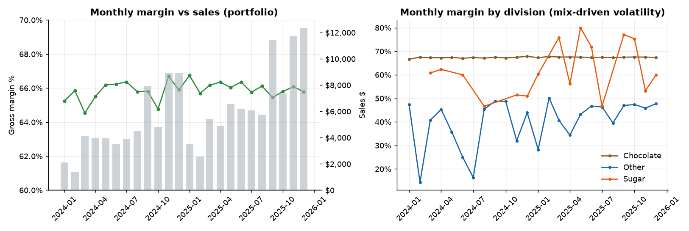
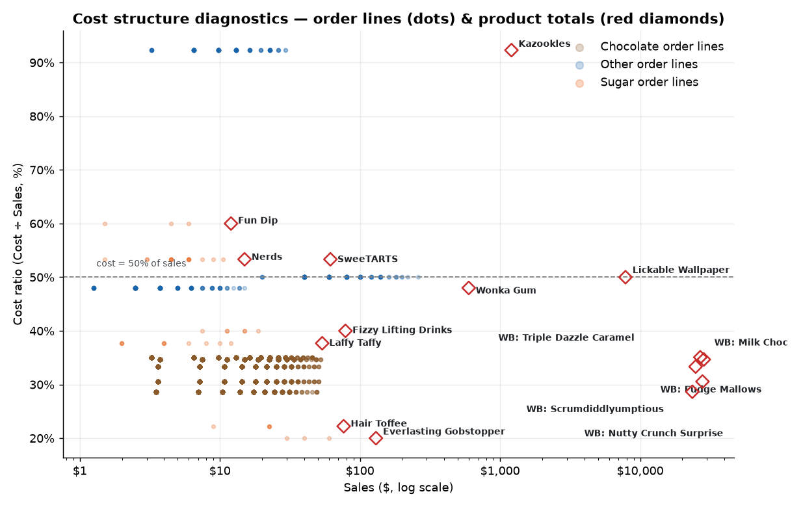
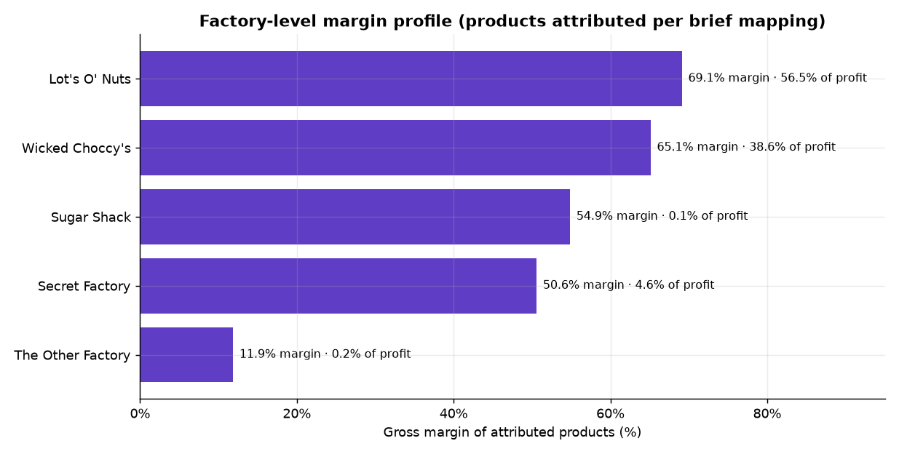

# Product Line Profitability & Margin Performance Analysis
## Nassau Candy Distributor — Research Paper (EDA, Insights, Recommendations)

| | |
|---|---|
| **Prepared for** | Unified Mentor — Data Analyst Capstone Project |
| **Dataset** | `Nassau_Candy_Distributor.csv` — 10,194 order-line records, 18 fields |
| **Analysis window** | 2 January 2024 – 31 December 2025 (order date) |
| **Companion deliverables** | Streamlit live dashboard (`app/streamlit_app.py`) · Executive summary (`reports/executive_summary.md`) |
| **Reproducibility** | `python -m src.data_prep` → `python analysis/run_eda.py` → `streamlit run app/streamlit_app.py` |

---

## 1. Abstract

Sales volume alone is a poor proxy for commercial success. This study converts 10,194 raw
order lines from Nassau Candy Distributor into product- and division-level margin
intelligence using a reproducible Python pipeline (validation → metric engineering →
quadrant, Pareto, cost-structure and volatility analysis → interactive Streamlit
dashboard). The portfolio earns **$141,783.63 in sales and $93,442.80 gross profit
(65.91% margin)** across FY2024–FY2025, with revenue growing **+44.6% YoY** at an
essentially flat margin (+0.13 pp). Profitability is highly concentrated: **5 of 15
products (33.3%) generate 95.1% of gross profit**, all of them Chocolate-division
Wonka bars. The Other division is margin-dilutive (44.8% vs 66% portfolio) and contains
the single structural risk product — **Kazookles, at a 7.7% margin with a 92.3% cost
ratio**. Conversely, seven tiny Sugar SKUs earn 40–80% margins at negligible volume,
representing a scale-up opportunity rather than a risk. Recommendations cover
repricing/cost renegotiation for Kazookles, discontinuation-review triggers, promotion
of high-margin pilot SKUs, and dependency-risk monitoring on the Chocolate franchise.

---

## 2. Background and Business Context

For distributors like Nassau Candy, some products sell in high volume but generate low
profit, consume disproportionate manufacturing cost, or *appear* successful while
weakening overall margins. Management lacks visibility into (i) which product lines
deliver the highest gross margin, (ii) whether high-sales products are actually
profitable, (iii) how profitability varies across divisions, and (iv) which products
represent margin risk. Without this, decisions on pricing, promotions and the product
portfolio stay reactive and intuition-based. This project provides the missing
evidence base.

**Objectives (from the project brief):**

1. Clean and validate the order extract.
2. Compute per-product profitability metrics (gross margin %, profit per unit,
   profit contribution).
3. Rank products and segment them into profit/margin quadrants.
4. Compare division-level financial efficiency and revenue-vs-profit imbalance.
5. Quantify profit concentration (Pareto) and over-dependency risks.
6. Diagnose cost structures and flag products for repricing, cost renegotiation or
   discontinuation review.
7. Deliver the analysis as an interactive Streamlit application.

---

## 3. Dataset

### 3.1 Source and scope

| Property | Value |
|---|---|
| Rows / columns | 10,194 × 18 |
| Unique orders | 8,549 |
| Order dates | 2024-01-02 → 2025-12-31 (24 complete months) |
| Geography | United States (9,994 lines, 50 states + DC) & Canada (200 lines) |
| Divisions | Chocolate, Sugar, Other |
| Regions | Atlantic, Gulf, Interior, Pacific |
| Products | 15 SKUs (after label standardisation) |
| Ship modes | Standard, First, Second Class, Same Day |

### 3.2 Field dictionary (as per brief)

| Field | Description | Field | Description |
|---|---|---|---|
| Row ID | Unique row identifier | Division | Product division |
| Order ID | Unique order identifier | Region | Region of customer |
| Order Date | Date of order (DD-MM-YYYY) | Product ID | Unique product identifier |
| Ship Date | Date of shipment | Product Name | Product long name |
| Ship Mode | Shipping method | Sales | Total sales value of order line |
| Customer ID | Unique customer identifier | Units | Total units of order line |
| Country/Region | Country of customer | Gross Profit | Sales − Cost |
| City / State / Postal Code | Customer destination | Cost | Manufacturing cost |

---

## 4. Methodology

### 4.1 Pipeline architecture

```
Nassau_Candy_Distributor.csv
        │
        ▼  src/data_prep.py  (Section 4.2 — cleaning & validation, logged report)
Clean order-line table (10,194 rows, 31 engineered columns)
        │
        ▼  src/analytics.py  (Section 4.3 — metric engine)
KPIs · product table · division table · Pareto · volatility · risk flags · factory table
        │
        ├──► analysis/run_eda.py  →  7 paper figures + CSV tables
        └──► app/streamlit_app.py →  5-module interactive dashboard
```

One shared analytics library feeds every deliverable, so the paper, the summary and
the dashboard quote identical numbers.

### 4.2 Data cleaning & validation (brief-mandated steps)

The cleaner (`data_prep.clean`) executes, and logs, each rule required by the brief:

| # | Rule (brief) | Implementation | Outcome on this extract |
|---|---|---|---|
| 1 | Validate cost and sales values | Coerce to numeric; reject non-numeric rows | 0 rows rejected |
| 2 | — accounting consistency | Enforce identity `Sales − Cost = Gross Profit` (tol $0.02) | holds **exactly** for all rows (max deviation $0.00) |
| 3 | Remove zero-sales or invalid profit records | Drop `Sales ≤ 0`, `Cost < 0`, `GP < 0`, `GP > Sales` | 0 rows |
| 4 | Handle missing unit values | Drop missing / non-positive `Units` (profit-per-unit undefined) | 0 rows (none missing) |
| 5 | Standardise product & division labels | Whitespace collapse + explicit fix: `"Wonka Bar -Scrumdiddlyumptious"` → `"Wonka Bar - Scrumdiddlyumptious"` | **2,064 rows standardised**; 15 unique products |
| 6 | Duplicates & dates | Drop exact/Row-ID duplicates; strict DD-MM-YYYY parsing | 0 duplicates; 0 unparseable dates |

**Data-quality verdict:** the extract is financially coherent. The only defect is the
product-label inconsistency above. Two source-data quirks are documented, not
"corrected": (i) *Ship Dates* fall in 2026–2030, i.e. after the 2024–2025 order
window — lead-time fields are therefore excluded from profitability analysis and kept
in the clean table for transparency only; (ii) per-SKU **unit price and unit cost are
constant across all 24 months** (e.g. Milk Chocolate is always $3.25/$1.14), which
means product-level margin volatility is structurally zero and all temporal margin
movement is assortment-mix driven (see §8.5).

### 4.3 KPI definitions (as per brief)

| KPI | Formula |
|---|---|
| Gross Margin (%) | Gross Profit ÷ Sales × 100 |
| Profit per Unit | Gross Profit ÷ Units |
| Revenue Contribution | Product sales ÷ total sales |
| Profit Contribution | Product gross profit ÷ total gross profit |
| Margin Volatility | Std-dev of monthly gross margin (pp); CV = σ ÷ mean |
| Cost Ratio | Cost ÷ Sales × 100 (= 100 − margin) |

### 4.4 Analytical frameworks

- **Profit–margin quadrants** — products split at portfolio medians of total gross
  profit and gross margin into *Star*, *Cash Trap*, *Hidden Gem*, *Laggard*.
- **Pareto / concentration** — cumulative contribution curves; products needed for
  80% of revenue/profit; Herfindahl–Hirschman Index (HHI, 0–100 scale) with bands
  ≥18 High / 10–18 Moderate / <10 Low dependency risk.
- **Cost-structure diagnostics** — order-line cost-vs-sales scatter against break-even
  guides; *cost-heavy/margin-poor* flag (cost ratio ≥ catalogue median **and** margin
  below median); action routing to *Repricing / Cost Renegotiation / Discontinuation
  Review / Maintain-Grow* driven by a configurable margin-risk threshold (default 25%,
  interactive in the dashboard).

---

## 5. Portfolio overview

| KPI | Value |
|---|---|
| Total Sales | **$141,783.63** |
| Total Cost of Goods | $48,340.83 |
| **Gross Profit** | **$93,442.80** |
| **Gross Margin** | **65.91%** |
| Units sold | 38,654 |
| Profit per unit | $2.42 |
| Orders | 8,549 |

| Fiscal year | Sales | Gross profit | Margin | Units |
|---|---|---|---|---|
| 2024 | $57,956.20 | $38,151.43 | 65.83% | 15,899 |
| 2025 | $83,827.43 | $55,291.37 | 65.96% | 22,755 |
| **Δ YoY** | **+44.6%** | **+44.9%** | **+0.13 pp** | **+43.1%** |

Growth is strong, margin-accretive in dollars, and achieved **without any margin
expansion** — every incremental dollar arrives at the existing price–cost ladders.

---

## 6. Product-level profitability analysis



### 6.1 Leaderboard (ranked by gross profit)

| # | Product | Division | Sales | Gross Profit | Margin | Profit/Unit | Profit share |
|---|---|---|---|---|---|---|---|
| 1 | Wonka Bar - Scrumdiddlyumptious | Chocolate | $27,874.80 | $19,357.50 | 69.44% | $2.50 | 20.72% |
| 2 | Wonka Bar - Triple Dazzle Caramel | Chocolate | $28,485.00 | $18,610.20 | 65.33% | $2.45 | 19.92% |
| 3 | Wonka Bar - Milk Chocolate | Chocolate | $26,867.75 | $17,443.37 | 64.92% | $2.11 | 18.67% |
| 4 | Wonka Bar - Nutty Crunch Surprise | Chocolate | $23,574.95 | $16,819.95 | **71.35%** | $2.49 | 18.00% |
| 5 | Wonka Bar - Fudge Mallows | Chocolate | $24,890.40 | $16,593.60 | 66.67% | $2.40 | 17.76% |
| 6 | Lickable Wallpaper | Other | $7,860.00 | $3,930.00 | 50.00% | **$10.00** | 4.21% |
| 7 | Wonka Gum | Other | $597.50 | $310.70 | 52.00% | $0.65 | 0.33% |
| 8 | Everlasting Gobstopper | Sugar | $130.00 | $104.00 | **80.00%** | $8.00 | 0.11% |
| 9 | **Kazookles** | Other | $1,205.75 | **$92.75** | **7.69%** | $0.25 | 0.10% |
| 10 | Hair Toffee | Sugar | $76.50 | $59.50 | 77.78% | $3.50 | 0.06% |
| 11 | Fizzy Lifting Drinks | Sugar | $78.75 | $47.25 | 60.00% | $2.25 | 0.05% |
| 12 | Laffy Taffy | Sugar | $53.73 | $33.48 | 62.31% | $1.24 | 0.04% |
| 13 | SweeTARTS | Sugar | $61.50 | $28.70 | 46.67% | $0.70 | 0.03% |
| 14 | Nerds | Sugar | $15.00 | $7.00 | 46.67% | $0.70 | 0.01% |
| 15 | Fun Dip | Sugar | $12.00 | $4.80 | 40.00% | $0.60 | 0.01% |

### 6.2 Quadrant segmentation



| Quadrant | Products | Reading |
|---|---|---|
| **Star** (high profit, high margin) | All 5 Wonka bars; Everlasting Gobstopper (marginal) | The Chocolate franchise anchors the P&L; protect availability and listing fees |
| **Cash Trap** (high sales, low margin) | Lickable Wallpaper, Wonka Gum | Lickable Wallpaper is the 2nd-largest revenue SKU (5.5%) yet dilutes margin by ~14 pp below the portfolio average; Wonka Gum adds breadth at 52% |
| **Hidden Gem** (low profit, high margin) | Hair Toffee (77.8%), Laffy Taffy (62.3%) | Under-distributed high-margin SKUs — distribution, not price, is the constraint |
| **Laggard** (low sales, low profit) | Kazookles, Fun Dip, Nerds, SweeTARTS, Fizzy Lifting Drinks | Kazookles is the only *structurally* loss-adjacent SKU (7.7%); the Sugar laggards are pilots with 2–10 order lines since launch |

**Are high-sales products actually profitable?** Mostly yes — the five revenue leaders
earn 65–71% margins. The exception is *Lickable Wallpaper* (#6 revenue, 50% margin)
and the *Kazookles* pattern in reverse: 96 order lines over 24 months make it *look*
like an active, healthy SKU while each unit earns only **$0.25 on a $3.25 price** —
clearly an "appears successful but weakens margins" case.

---

## 7. Division-level performance



| Division | Sales | Revenue % | Gross Profit | Profit % | Margin | Imbalance (pp) | Margin σ | Classification |
|---|---|---|---|---|---|---|---|---|
| Chocolate | $131,692.90 | 92.88% | $88,824.62 | 95.06% | **67.45%** | −2.17 | 0.24 | Strong financial efficiency |
| Other | $9,663.25 | 6.82% | $4,333.45 | 4.64% | **44.84%** | **+2.18** | 10.17 | **Structural margin issues** |
| Sugar | $427.48 | 0.30% | $284.73 | 0.30% | 66.61% | −0.00 | 11.08 | Strong margin, negligible scale |

- **Chocolate** is the engine: it over-delivers profit per revenue point (+2.17 pp
  profit-over-indexing) with near-deterministic margins (σ = 0.24 pp/month).
- **Other** *under-earns* by 2.18 pp — the division books 6.8% of revenue but keeps
  only 4.6% of profit, entirely due to Kazookles (7.7% margin) dragging the
  well-performing Lickable Wallpaper/Wonka Gum pair.
- **Sugar** is a margin-healthy (66.6%) micro-division: 40 order lines over 24 months
  — most SKUs launched 2025 — i.e. a pilot program awaiting distribution, not a
  failing one.

---

## 8. Profit concentration (Pareto) analysis



| Indicator | Revenue basis | Profit basis |
|---|---|---|
| Products needed for 80% | **5 of 15 (33.3%)** | **5 of 15 (33.3%)** |
| Top-product share | 20.1% (Triple Dazzle Caramel) | 20.7% (Scrumdiddlyumptious) |
| Top-3 share | 58.7% | 59.3% |
| Top-5 share | 92.9% | **95.1%** |
| HHI (0–100) | 17.66 — Moderate | 18.31 — **High** |

The same five Wonka bars sit at the top of *both* curves: one assort­ment decision,
one supplier problem or one cocoa-price shock in the Chocolate division moves the
entire P&L. Below them, 10 SKUs share <8% of revenue. **Geographic congestion:**
California (19.7%), New York (11.0%) and Texas (9.5%) carry ≈40% of sales — the
corridors where logistics or demand shocks bite hardest; region margins, however, are
flat (65.5%–66.4%), so congestion is a revenue-load issue, not a margin issue.

### 8.5 Margin volatility

Because unit price and cost are fixed per SKU, **product-level monthly margin
volatility is exactly 0 pp** — the only moving part is *mix*. Portfolio monthly margin
oscillates in a narrow 64.5%–66.8% band (worst: Mar-2024 64.54%; best: Jan-2025
66.75%). Division-level σ tells the risk story: Chocolate 0.24 pp (stable) vs Other
10.2 pp and Sugar 11.1 pp (noisy, low-volume months swinging with single orders).
Margin risk in this business is therefore **structural (price–cost ladders), not
temporal (volatility)** — reinforcing that pricing/sourcing decisions, not promotion
timing, are the lever.



---

## 9. Cost-structure diagnostics



Order lines plot in clean horizontal bands (the fixed unit-cost ladders), confirming
zero discounting. Three diagnostic groups emerge:

| Group | Products | Cost ratio | Diagnosis |
|---|---|---|---|
| Cost-heavy, margin-poor | **Kazookles (92.3%)**, SweeTARTS (53.3%), Fun Dip (60.0%), Nerds (53.3%) | ≥50% | Price barely covers cost; any input inflation turns Kazookles loss-making |
| Pricing-inefficiency watch | Lickable Wallpaper (50.0%), Wonka Gum (48.0%) | 45–50% | Premium SKUs priced at exactly 2× cost — margin ceiling by construction |
| Lean-cost, high-margin | 5 Wonka bars (28.6–35.1%), Gobstopper (20.0%), Hair Toffee (22.2%), Laffy Taffy (37.7%), Fizzy (40.0%) | <50% | Efficient ladders; priority for volume investment |

**Action register (25% risk threshold):**

| Product | Margin | Cost ratio | Recommended action |
|---|---|---|---|
| **Kazookles** | 7.69% | 92.3% | **Cost renegotiation ∨ repricing — discontinuation review if neither reaches ≥25% within two review cycles** |
| SweeTARTS / Nerds / Fun Dip | 40–47% | 53–60% | Re-monitored at higher thresholds; renegotiate co-manufacturing terms while scaling |
| Lickable Wallpaper | 50.0% | 50.0% | Cost renegotiation: it is the #2 revenue SKU — every 1 pp cost saving ≈ $79/yr on current volume |

### Factory view (products attributed per the brief's correlation table)



| Factory | Attributed SKUs | Sales | Profit | Margin | Cost ratio |
|---|---|---|---|---|---|
| Lot's O' Nuts | Scrumdiddlyumptious, Fudge Mallows, Nutty Crunch | $76,340.15 | $52,771.05 | **69.13%** | 30.87% |
| Wicked Choccy's | Milk Chocolate, Triple Dazzle Caramel | $55,352.75 | $36,053.57 | 65.13% | 34.87% |
| Secret Factory | Lickable Wallpaper, Wonka Gum, Gobstopper | $8,587.50 | $4,344.70 | 50.59% | 49.41% |
| Sugar Shack | Laffy Taffy, SweeTARTS, Nerds, Fun Dip, Fizzy¹ | $220.98 | $121.23 | 54.86% | 45.14% |
| The Other Factory | Kazookles, Hair Toffee | $1,282.25 | $152.25 | **11.87%** | **88.13%** |

¹ *Division note:* the brief lists Fizzy Lifting Drinks under "Other"; the transactional
data labels it **Sugar** — the data value is used throughout, flagged here for the
master-data team.

Sourcing implication: 56.5% of profit sits in one facility (Lot's O' Nuts, AZ) — a
capacity/continuity consideration as volume grows +45%/yr. The Other Factory (TN)
requires an immediate cost-structure review; it converts $0.88 of every sales dollar
into cost.

---

## 10. Regional, channel and fulfilment observations

- **Regions** are margin-indifferent (65.5–66.4%) but volume-differentiated — Pacific
  32.7% of sales > Atlantic 29.1% > Interior 22.6% > Gulf 15.7%. Gulf is the
  under-penetrated region, not an unprofitable one.
- **Ship modes** all clear 65.7–66.1% margin; freight tier does not erode product
  margin, so fulfilment policy can pursue service rather than margin rescue.
- **Canada** (200 lines, $2,953 sales, 65.5% margin) matches US profitability — an
  expansion-ready, margin-neutral market.

---

## 11. Key findings

1. **Growth without margin expansion.** +44.6% sales YoY at a flat 65.9% margin —
   the model scales, but pricing discipline is the only future margin lever.
2. **Extreme concentration.** 33.3% of SKUs produce 95.1% of profit (HHI 18.3 =
   High dependency). The Chocolate division is a single point of failure.
3. **One structural risk product.** Kazookles: 7.7% margin, $3.00 cost vs $3.25
   price, 92.3% cost ratio, still rising in units (+5% YoY) — volume growth that
   *destroys* blended margin.
4. **Dilutive division.** Other is +2.18 pp revenue-over-profit imbalanced (44.8%
   margin) because of Kazookles and the 2×-cost pricing ceiling on Lickable
   Wallpaper/Wonka Gum.
5. **Hidden high-margin bench.** Sugar pilot SKUs (Gobstopper 80%, Hair Toffee
   77.8%, Laffy Taffy 62.3%) earn top margins at <0.3% revenue — upside of the
   portfolio, not downside.
6. **Zero temporal margin volatility at SKU level** (fixed price–cost ladders);
   noise lives only in mix. Margin management = assortment + sourcing management.

---

## 12. Recommendations

| # | Action | Owner | Detail |
|---|---|---|---|
| R1 | **Kazookles 90-day plan** | Commercial + Sourcing | Open cost renegotiation with The Other Factory and/or reprice from $3.25 to ≥$4.50 (cost÷75% ⇒ 25% margin); if neither clears the 25% threshold within two cycles, discontinue (0.10% profit share is fully absorbable) |
| R2 | **Cost-ceiling negotiation on the 2× SKUs** | Sourcing | Lickable Wallpaper & Wonka Gum are hard-capped at ~50% margin by 2× pricing; target 45% cost ratio ⇒ ≈$170/yr added profit on current volume |
| R3 | **Scale the Sugar pilots** | Sales/Marketing | Gobstopper/Hair Toffee/Laffy Taffy margins (62–80%) exceed every Wonka bar; expand listings beyond 2–10 lines/month and measure velocity |
| R4 | **Dependency watch-KPIs** | Finance | Track Chocolate profit share (95.1%), top-5 SKU share, and Lot's O' Nuts capacity quarterly; set an alert if top-5 profit share exceeds 96% |
| R5 | **Gulf distribution push** | Sales | Gulf combines lowest penetration (15.7%) with in-line margin (66.1%) — cheapest headroom |
| R6 | **Promo guardrail** | Revenue mgmt. | With fixed ladders, any discount flows 1:1 out of margin; cap promo depth at 10% on Stars, 5% elsewhere |
| R7 | **Data governance** | IT/Analytics | Persist label-standardisation fixes, repair Ship Date generation (2026–2030 anomaly), add per-SKU price/cost effective dates so real volatility becomes measurable |

---

## 13. Streamlit dashboard (live analytics)

Modules implemented exactly per the brief:

| Module | Contents |
|---|---|
| 📈 Executive Overview | KPI cards, monthly sales×margin, regional heat bars, factory geo-map & scorecard |
| 🏆 Product Profitability | Margin leaderboard, profit-contribution bars, quadrant map, full styled product table + CSV download |
| 🏭 Division Performance | Revenue-vs-profit comparison, margin distribution (box), share deltas, division margin volatility |
| 🧯 Cost vs Margin Diagnostics | Cost–sales scatter (log, with break-even guides), margin-risk register, cost-heavy flags, unit-economics stacks |
| 📊 Profit Concentration | Pareto charts (revenue/profit toggle), dependency indicators (top-1/3/5, HHI), geographic congestion bars |

**User capabilities:** date-range selector, division filter (plus optional region
filter), **margin-risk threshold slider** that re-derives every flag and the risk
register live, and free-text **product search**; optional raw-record viewer.

---

## 14. Limitations and data notes

1. Ship Dates (2026–2030) post-date the order window — excluded from analysis;
   retained in the clean dataset for transparency.
2. Unit price/cost are constant per SKU, so the *Margin Volatility* KPI is zero at
   product level by construction; division-level (mix) volatility is reported
   instead. No discounting behaviour can be observed.
3. The dataset reads as a teaching/sample extract (small absolute dollars,
   Wonka-branded SKUs); methods and thresholds are production-portable.
4. Sugar-division volumes are too small (≤10 lines/SKU) for inferential claims;
   findings there are directional.
5. Median-split quadrants on a 15-SKU catalogue produce a low "high-profit" bar
   ($104); quadrant labels should be read relative to the catalogue.
6. The brief's closing paragraph references "shipping route efficiency" — inherited
   template text from a sister project; this work addresses the brief's stated
   profitability/margin scope (factories are used for the §9 sourcing view).

---

## 15. Conclusion

Nassau Candy's P&L is a two-speed system: a spectacularly efficient chocolate
franchise (95% of profit at 67–71% margins) carrying a small, dilutive tail. The
highest-value management actions are surgical, not sweeping — fix or exit one
structurally broken SKU (Kazookles), unlock the 2×-priced premium pair through
sourcing, and scale the quietly excellent Sugar pilots — while putting formal
watch-KPIs around a concentration level (5 SKUs = 95% of profit) that leaves the
business one chocolate-supply shock away from a margin event. All of this is now
monitorable continuously in the companion Streamlit dashboard.

---

## Appendix A — Factory reference (project brief)

| Factory | Latitude | Longitude |
|---|---|---|
| Lot's O' Nuts | 32.881893 | −111.768036 |
| Wicked Choccy's | 32.076176 | −81.088371 |
| Sugar Shack | 48.11914 | −96.18115 |
| Secret Factory | 41.446333 | −90.565487 |
| The Other Factory | 35.1175 | −89.971107 |

## Appendix B — Reproduce

```bash
pip install -r requirements.txt
python -m src.data_prep          # clean + validate (+ JSON cleaning report)
python analysis/run_eda.py       # regenerate 7 figures + 6 CSV tables
streamlit run app/streamlit_app.py
```
